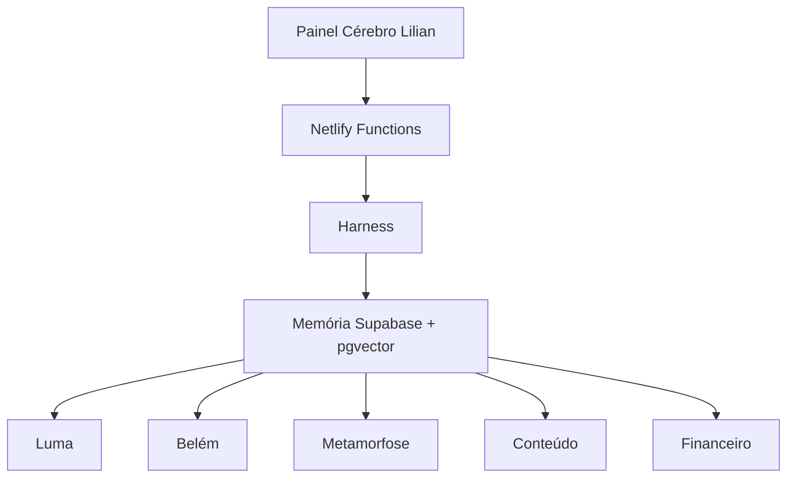

# Cérebro Lilian

O segundo cérebro central dos seus agentes. Ele não substitui suas decisões: dá contexto, organiza relações e impede que cada frente aja como se estivesse sozinha.

## O que existe nesta primeira versão

- Memória central no Supabase: projetos, decisões, tarefas, fontes, notas, pessoas e eventos.
- Relações tipadas entre memórias: depende de, informa, bloqueia, pertence a e outras.
- Busca semântica com pgvector e HNSW, com fallback para busca em português por palavras.
- Harness que escolhe Luma, Belém, Metamorfose, Conteúdo ou Financeiro, recupera contexto antes de agir e bloqueia ações sensíveis.
- API Netlify: `/api/brain-search`, `/api/harness` e `/api/brain-graph`.
- Ingestão com uma fila rastreável para texto, links, PDFs, imagens, áudios, vídeos, Instagram salvos, Gmail, Drive, Shopify e Browser Use.
- Primeiro fluxo validado: `/api/luma-run` recupera memória, aplica a política de autorização, registra a ação e devolve o resultado para o cérebro.
- Painel inicial com busca, grafo e roteamento de tarefas.

## Arquitetura



## As três camadas

| Camada | Responsabilidade |
| --- | --- |
| Memória | Fatos, decisões, projetos, tarefas, fontes, arquivos, histórico e relações. A fonte da verdade única. |
| Inteligência | Embeddings, busca semântica, RAG, grafo, relações e recuperação de contexto. |
| Ação | Harness, agentes especializados, conectores, Browser Use e automações. |

O percurso de toda informação é **CAPTURAR → ENTENDER → ORGANIZAR → RELACIONAR → RECUPERAR → AGIR**. Os agentes não mantêm uma memória principal separada; recebem o contexto recuperado da mesma base central.

O navegador não recebe a chave de serviço. A memória fica com RLS ativada e sem permissão para `anon` e `authenticated`; as funções Netlify usam a chave de serviço apenas no servidor.

## Rodar localmente

```bash
npm install
npm run dev
```

Para usar as APIs conectadas, copie `.env.example` para `.env` e preencha as variáveis. Sem elas, o painel abre em modo de demonstração seguro e o harness ainda mostra a rota prevista.

## Preparar o Supabase

1. Criar um projeto separado chamado `Cérebro Lilian`.
2. Aplicar `supabase/migrations/20260928010000_brain_schema.sql`.
3. Inserir `SUPABASE_URL` e `SUPABASE_SERVICE_ROLE_KEY` no Netlify.
4. Inserir `OPENAI_API_KEY` apenas se quiser gerar embeddings reais. O modelo usado é `text-embedding-3-small` com 1536 dimensões, igual à coluna vetorial.
5. Para os registros iniciais terem busca semântica, gere embeddings para eles depois de configurar a chave. A busca por palavras já funciona sem essa chave.

## Contrato do harness

`POST /api/harness`

```json
{ "task": "revisar a margem dos produtos aprovados da Luma" }
```

Ele devolve o agente, a quantidade de contexto recuperado e o estado. Se a tarefa contém compra, pagamento, envio a cliente, publicação, exclusão ou cancelamento, o estado vira `waiting_approval`.

## Primeiro fluxo completo: Luma

`POST /api/luma-run`

```json
{ "objective": "analisar os produtos aprovados e suas margens", "execution": true }
```

1. Recupera decisões, produtos, fornecedores e limites já registrados no cérebro.
2. Cria um `agent_run` e uma `agent_action` com identificadores de auditoria.
3. Se for só análise, conclui e grava uma nota de resultado no cérebro.
4. Se envolver publicação, compra, pagamento ou comunicação, para em `waiting_approval` até receber uma autorização registrada.
5. A futura integração Shopify será uma ação separada, com autorização própria, e não uma consequência automática de uma análise.

## Próxima camada

- Registrar cada conversa e arquivo como fonte com procedência.
- Tela para aprovar, rejeitar e corrigir decisões do harness.
- Fila de tarefas por agente com execução assistida.
- Conectores específicos: Shopify/Luma, reservas Belém, calendário, e-mail e financeiro.
