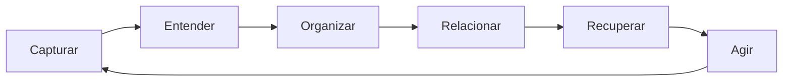

# Arquitetura do Cérebro Lilian

## Princípio

Nenhum agente começa no escuro. Antes de planejar ou executar, o harness identifica o assunto, recupera as memórias mais próximas e registra o que foi decidido.

## Camadas e ciclo

| Camada | Conteúdo |
| --- | --- |
| Memória | `brain_nodes`, fontes de ingestão, fatos extraídos, relações e linha do tempo auditável. |
| Inteligência | pgvector, busca textual, RAG, seleção de contexto e grafo. |
| Ação | Harness, cinco agentes, conectores, Browser Use e automações. |

## Dados

| Entidade | Para quê serve |
| --- | --- |
| `brain_nodes` | Unidade única de memória. Pode ser projeto, decisão, tarefa, fonte, nota, pessoa ou evento. |
| `node_relations` | Explica por que duas memórias estão conectadas e a força dessa ligação. |
| `agents` | Define os cinco agentes e suas capacidades. |
| `agent_runs` | Histórico de cada pedido encaminhado pelo harness, contexto usado e estado de aprovação. |
| `ingestion_items` | Registro original de cada texto, link ou arquivo e seu estágio de processamento. |
| `memory_claims` | Fatos extraídos com fonte e nível de confiança, sem perder o material original. |
| `agent_actions` | Cada ação planejada ou executada, autorização e chave de idempotência. |
| `brain_events` | Linha do tempo auditável. Não substitui decisões antigas de maneira silenciosa. |
| `memory_entities` | Pessoas, marcas, produtos, clientes, assuntos e outros nomes identificados durante a ingestão. |
| `node_entity_mentions` | Prova qual memória mencionou cada entidade e com qual confiança. |

Cada nó tem conteúdo pesquisável, metadados, data de origem, fonte, estado, responsável e embedding opcional. O texto completo nunca precisa ficar perdido dentro de uma conversa sem ligação.

## Roteamento

1. O pedido chega em `/api/harness`.
2. O harness calcula o agente mais adequado pelas capacidades e palavras do domínio.
3. Gera embedding quando a chave está configurada.
4. Busca no `match_brain_nodes` e monta o contexto.
5. Verifica a política de aprovação.
6. Cria um `agent_run` com rastreabilidade.
7. O executor do agente recebe tarefa, contexto e limites.
8. O resultado, decisão ou falha volta como nó e evento para o cérebro.

## Ingestão

O endpoint `POST /api/ingest` já aceita referência de texto, link ou arquivo. Ele classifica automaticamente o assunto, atribui um agente sugerido, cria o item de ingestão e, quando há texto, cria a memória e o fato extraído. Os arquivos binários ficam previstos para Storage privado e são identificados por `storage_path`.

Conectores futuros não criam bancos isolados: Gmail, Google Drive, Instagram salvos, Shopify e Browser Use escrevem `ingestion_items` e fontes nesta mesma base. O mesmo vale para extração de PDF, OCR de imagem, transcrição de áudio e vídeo.

## Luma como fluxo de validação

`/api/luma-run` é o primeiro agente que fecha o ciclo. Ele recupera a memória Luma, cria uma execução, registra a ação, evita conectores externos sem autorização e devolve a análise como nova memória e evento. Publicar na Shopify ficará separado como ação de alto impacto, nunca automática.

## Estrutura da vida real

O grafo não tem uma lista fixa de bolinhas no código. Ele é calculado da memória central a cada leitura.

Os seis núcleos permanentes são registros estruturais: **Lilian Cristina**, **Fotografia / Estúdio**, **Metamorfose**, **Luma**, **Financeiro** e **Vida Pessoal**. Eles aparecem maiores por terem ciclo de vida `permanente` e papel estrutural.

Projetos usam `lifecycle`: `permanente`, `sazonal`, `temporario` ou `arquivado`. Belém 2026 é `temporario`, fica ligado a **Fotografia / Estúdio → Campanhas → Belém 2026** e, quando acabar, torna-se `arquivado`: continua na busca e no histórico, mas sai do destaque do mapa.

A função `get_brain_graph` calcula o peso visual por ciclo de vida, relações, frequência de uso e atividade recente. A ingestão cria chave canônica para evitar duplicatas, associa a memória ao núcleo adequado e, quando houver embeddings, liga conteúdos semelhantes automaticamente.

## Segurança

- Chaves de serviço vivem apenas nas variáveis do Netlify.
- RLS está ativo em todas as tabelas expostas.
- Papéis de navegador não podem ler a memória diretamente.
- Ações que movimentam dinheiro, falam com clientes ou alteram dados de modo irreversível chegam como `waiting_approval`.
- Fontes podem armazenar URL, tipo e data para que uma decisão seja auditável depois.

## O que o primeiro corte não faz sozinho

Ele não inventa contexto, não executa pagamentos e não se conecta automaticamente a cada plataforma. A estrutura já está pronta para receber cada conector em etapas sem quebrar a memória central.
